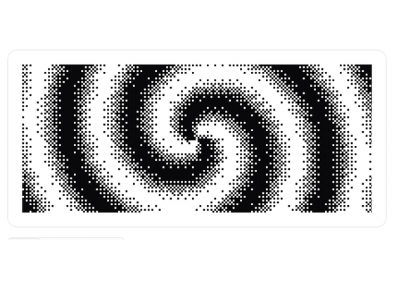
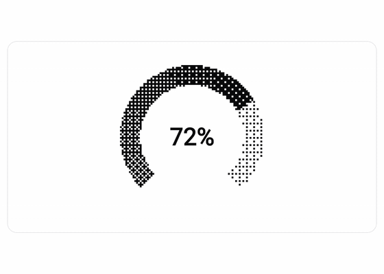
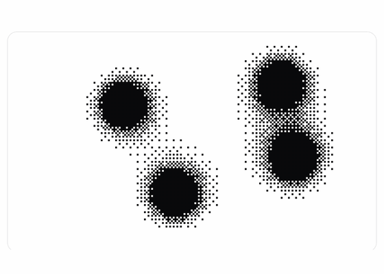

<p align="center"></p>

# Stipple

[](https://central.sonatype.com/artifact/io.github.jantursky/stipple) [](https://github.com/jantursky/stipple/actions/workflows/ci.yml) [](https://kotlinlang.org) [](LICENSE) [](https://codecov.io/gh/jantursky/stipple)

[Docs](https://stipple-docs.vercel.app) · [Demo](https://stipple-demo.vercel.app) · [Maven Central](https://central.sonatype.com/artifact/io.github.jantursky/stipple) · [Changelog](CHANGELOG.md)

Stipple: dithered UI for Compose Multiplatform. A small dither engine, modifiers that dither any element, and ten ready-made components: buttons, charts, gauges, text, avatars, images and backgrounds. Android, iOS, desktop and the browser, from one `commonMain`.

A dither turns a smooth tone into a pattern of ink and paper dots. Stipple splits that into three pieces you can swap on their own: a **field** that says how much ink each point wants, a **pattern** (Bayer 2, 4, 8, blue noise or your own) that decides which cells turn on, and a **theme** with the colours and the cell size. Everything else is built from those.

### Engine and modifiers

<picture>
  <source media="(prefers-color-scheme: dark)" srcset=".github/assets/engine-dark.gif">
  
</picture>

### Components

<picture>
  <source media="(prefers-color-scheme: dark)" srcset=".github/assets/components-dark.gif">
  
</picture>

### Backgrounds and interface pieces

<picture>
  <source media="(prefers-color-scheme: dark)" srcset=".github/assets/backgrounds-dark.gif">
  
</picture>

| folder               | what it is                                                                                           |
| -------------------- | ---------------------------------------------------------------------------------------------------- |
| `stipple`            | The engine and the modifiers, published as `io.github.jantursky:stipple`. No Material dependency.    |
| `stipple-components` | The ten components, published as `io.github.jantursky:stipple-components`.                           |
| `skills/stipple`     | An agent skill that teaches a coding agent to build with Stipple.                                    |
| `samples/gallery`    | The gallery's examples and their controls, shared by the web, desktop and mobile gallery.            |
| `samples/web`        | The gallery in the browser: every page live, with its source next to it.                             |
| `samples/desktop`    | The same gallery in a desktop window: `./gradlew :samples:desktop:run`.                              |
| `samples/androidApp`, `samples/iosApp` | The same gallery as Android and iOS apps (shared code in `samples/app`).           |
| `apps/docs`          | The docs site, built with [Blume](https://www.npmjs.com/package/blume).                              |

## Install

```kotlin
// build.gradle.kts
kotlin {
    sourceSets {
        commonMain.dependencies {
            implementation("io.github.jantursky:stipple:1.0.0")
            // Optional:
            implementation("io.github.jantursky:stipple-components:1.0.0")
        }
    }
}
```

The engine needs Compose runtime, foundation, UI and animation. Android needs minSdk 23.

## Usage

Dither an element with a field and a pattern:

```kotlin
Box(
    Modifier
        .size(240.dp)
        .dither(DitherFields.radial(), DitherPatterns.Bayer4),
)
```

Dithers are static. Pass `animated = true` for a field that moves, and `stillTime` for the frame a reduced-motion user sees:

```kotlin
Box(Modifier.fillMaxWidth().height(200.dp).dither(DitherFields.waves(), animated = true, stillTime = 1f))
```

Set the colours and the cell size once, and every dither below follows:

```kotlin
ProvideStippleTheme(StippleTheme.Light.copy(cell = 2.dp)) {
    DitherProgressBar(progress = 0.6f, contentDescription = "Upload progress")
    DitherButton(text = "Retry", onClick = { })
}
```

A new look is a new field, one function of position and time:

```kotlin
private val spiral = DitherField { x, y, t, aspect ->
    val dx = (x - 0.5f) * aspect
    val dy = y - 0.5f
    0.5f + 0.5f * sin(hypot(dx, dy) * 14f - atan2(dy, dx) * 2f - t * 2f)
}
```

The [docs](https://stipple-docs.vercel.app) cover theming, patterns and fields, writing your own dither, choosing a renderer, performance and accessibility.

## Demo

The [gallery](https://stipple-demo.vercel.app) shows every pattern, field, modifier and component live, with controls for the pattern, cell size, colours, animation and reduced motion, a frame-time meter, and the source of each example next to it. The same gallery runs as a desktop window, an Android app and an iOS app.

## How it works

1. A **field** (`stipple/src/commonMain/.../DitherField.kt`) returns a tone from 0 (paper) to 1 (ink) for a point `(x, y)` at time `t`. Fields are pure functions, so they work in common code and are easy to test.
2. A **pattern** (`DitherPattern`) is a threshold map. The Bayer patterns are built recursively and blue noise is a 64 by 64 void-and-cluster texture made offline by `scripts/blue-noise.py`.
3. A cell is ink when the tone is above the pattern's threshold for that cell. With a palette of three or more colours the tone picks a position on the ramp and the pattern decides between the two colours around it.
4. The **cell renderer** samples the field once per cell and draws neighbouring cells of one colour as one rectangle. The optional **shader renderer** draws the whole element with one fragment shader (AGSL on Android 13 and later, a Skia runtime effect elsewhere) and falls back to cells wherever it can't.
5. Modifiers are `Modifier.Node`s. The animation clock is snapshot state that only the draw block reads, so a frame redraws the element and recomposes nothing. Tests count recompositions.
6. Reduced motion is read from the platform and freezes every animation at the field's still frame. Progress and values keep updating, because they are information.
7. `ditherImage` reads what an element draws back once, dithers it on a background dispatcher with ordered dithering, Floyd-Steinberg or Atkinson error diffusion, and caches the result.

## Prior art

- [dithercn](https://dithercn.dev) is the closest relative: dithered components for React and shadcn, one engine under many pieces, with a skill for coding agents. Stipple takes the idea, not the code, and credits it in [NOTICE](NOTICE).
- [Paper Shaders for Android](https://github.com/AndreFrelicot/paper-shaders-android) ports Paper Design's shaders, including dithering and halftone, to AGSL. It is Android only, needs API 33 and isn't on Maven.
- [dither-kit-compose](https://github.com/ryumacodes/dither-kit-compose) is a set of dithered Compose components. It has one Bayer pattern, no field or pattern abstraction, no modifiers and no web target.

Stipple adds a small engine of its own, modifiers for any element, a cell renderer that works back to Android 6, an optional shader renderer, error diffusion for images, reduced motion on every platform and an agent skill.

## Not covered yet

- Mesh gradients, globes, maps, and the scramble and dissolve text effects from dithercn.
- A shader for the built-in `noise` and `sweep` fields, for blue noise, for dot-shaped cells and for palettes of more than two colours: those use the cell renderer.
- The shader renderer applies to `Modifier.dither`, not to `ditherFill` or `ditherMask`.
- Frame times on low-end Android devices and on a physical iPhone are not measured.
- The docs' code samples are plain snippets; only the agent skill's examples are compiled by a test.

## Platform support

| platform | cell renderer | shader renderer | reduced motion from | checked on |
| --- | --- | --- | --- | --- |
| Android 13+ (API 33) | yes | AGSL | animator duration scale | Samsung SM-G991B, Android 15; Robolectric tests |
| Android 6 to 12 (API 23 to 32) | yes | no, uses cells | animator duration scale | Robolectric tests; not on a device |
| iOS | yes | Skia runtime effect, **unverified** | Reduce Motion | simulator tests and the gallery on an iPhone 17 simulator; not on a device |
| JVM desktop | yes | Skia runtime effect | none, use `LocalStippleMotion` | tests and screenshots on macOS |
| wasmJs | yes | Skia runtime effect | `prefers-reduced-motion` | Chromium and WebKit (the engine of Safari) via Playwright, software GL; not Firefox, not Safari itself |

Built with Kotlin 2.4 and Compose Multiplatform 1.12.

## Development

Needs JDK 17+, the Android SDK, Xcode for the iOS simulator, and [Bun](https://bun.sh) 1.3+ with Node 22.19+ for the docs, the browser tests and the screenshots.

```sh
./gradlew :stipple:check :stipple-components:check   # tests on JVM, Android (Robolectric), iOS simulator and wasm, plus coverage
./gradlew spotlessCheck apiCheck                     # format and public API
./gradlew :samples:desktop:run                       # the gallery in a desktop window
./gradlew :samples:web:wasmJsBrowserDevelopmentRun   # the gallery in the browser
./gradlew :samples:androidApp:installDebug           # the gallery on a device or emulator
bun install && bun run build:docs                    # the docs site
bun run test:web                                     # browser tests (after :samples:web:wasmJsBrowserDistribution)
bun run screenshots                                  # the GIFs above
./scripts/pack-test.sh                               # publish to Maven Local and compile a fresh consumer
```

See [CONTRIBUTING.md](CONTRIBUTING.md) for the layout and the conventions.

## License

[MIT](LICENSE). Stipple was inspired by dithercn; see [NOTICE](NOTICE).
